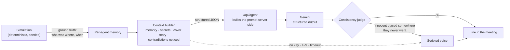

# Alibi

**A deep-sea social deduction game where every suspect is an AI agent with its own memory, and the killer lies.**

Six divers are sealed inside Halcyon-9, a research station 300 metres down, while a storm rages
above. One of them is killing the others. Walk the station, do tasks for true sonar logs, find the
body, then question the crew at the emergency meeting. Their alibis come from what they actually
saw. The killer's comes from a cover story.

**The twist is pacts.** The killer can corner you and offer a deal: vouch for them and win on their
side, or **take the knife** and swap roles. Refuse, and you know who did it, but can you convince
the others? Play as the killer and you can make the same offer. Some divers accept, some refuse,
and some only pretend so they can expose you at the next meeting.

**▶ Play it: [alibi-delta-lac.vercel.app](https://alibi-delta-lac.vercel.app)**

## How to play

| | |
|---|---|
| Move | WASD / arrow keys, or click or tap where to go |
| Task | stand on a dashed ring and press **E** (or Use) to open its mini-game |
| Report a body | **R** |
| Emergency meeting | **M** in the Mess Hall, once per game |
| Security cameras | **C** at the Comms desk; Esc or any movement to leave |
| Sabotage (killer) | **B** blackout · **V** hull breach |
| Fix sabotage | hold **E** at the breaker panel or a pressure valve |
| Kill (killer) | **K** when you're alone with someone |
| Offer a deal (killer) | **Q** when you're alone with someone |

- The camera follows you through the station; the minimap (top right) shows where you are and your open tasks.
- Every room is furnished and solid: a moon pool with a docked sub, a sonar wall, jellyfish tanks, a pulsing reactor
  core, sick-bay beds, kelp rows. You and the crew walk around it all.
- **Security cameras:** stand at the Comms desk and press **C** to watch live feeds of the Sub Dock, Bio Lab,
  Reactor and Medbay. While anyone watches, every camera's red light is on, so the killer knows to avoid those
  rooms. The crew use the desk too: a murder caught on camera gets named at the meeting, and anyone who watched
  a room can disprove a false alibi about it.
- **Sabotage:** the killer can cut the power or crack the hull.
  - *Blackout:* the crew see only as far as their helmet lamps, the cameras show static, and the killer, who has
    night vision, can strike in a dark room unseen. Restore power at the breaker panel in the Reactor.
  - *Hull breach:* a 45-second countdown. Close the pressure valves in the Sub Dock **and** Hydroponics, or the
    sea comes in and the killer wins.
  - The AI crew run to fix both, the AI killer uses them for cover, and everyone at the next meeting knows when
    the lights went out. Only the killer knows who did it.
- **Task mini-games:** every task is a short puzzle, themed to the room. *Pressure dial* (hold a creeping needle
  in the green: ballast, coolant, core, microscope focus), *cable splice* (match cables to sockets: purifier,
  oxygen, pump), *specimen match* (pick the exact match three times: vent culture, cargo seals) and *timing
  sweep* (strike as the sweep crosses the target: sonar, ping, vitals, kelp). The station keeps moving while you
  work, so you're exposed. Fixing sabotage stays a quick hold-E.
- You only see people in the same room or tube as you.
- Each finished task pulls one **true** sonar log ("Kenji was in Reactor 02:31–02:40").
- The storm clears after three meetings. If the killer is still aboard, the killer's side wins.
  The killer's side also wins once it equals the crew in number.
- At the end, **Who lied** checks every alibi against where people really were.

## How the agents work



- **The simulation decides the truth, and the model only does the talking.** Movement, kills and
  sightings are plain TypeScript with a seeded RNG, so a game replays exactly. Nothing about *what
  happened* comes from an LLM.
- **Each character only knows what it saw.** Memory is computed from who shared a room with whom,
  and for how long. An innocent's prompt never contains the killer's secrets. That's tested.
- **The killer gets a cover story.** It's the true route, except the stretch around the kill is moved
  to a room nobody else was in at the time, so no single witness can disprove it. Only careful
  cross-checking can.
- **Contradictions are computed, not hallucinated.** When Mara claims the Bio Lab and Juno was in the
  Bio Lab then without seeing her, the sim detects it and gives it to Juno as "things you noticed".
  A test checks that a truthful alibi is never flagged.
- **Innocents can't lie by accident.** If the model places an innocent somewhere they never went, the
  line is replaced, and an innocent's checkable claims are always their real movements.
- **It works with no key at all.** A scripted voice builds alibis, challenges and votes from the same
  data. It's used offline, and line by line whenever Gemini fails, so a demo never breaks.

## Running it

```bash
npm install
cp .env.example .env.local   # add GEMINI_API_KEY, or leave it empty for scripted voices
npm run dev
```

```bash
npm test          # 51 tests: simulation, memory, judge, pacts, win rules, director fallbacks, rate limits
npm run typecheck
npm run lint
npm run build
```

### Deploying to Vercel

1. Import the repo in Vercel (framework: Next.js, no extra settings).
2. Add the environment variables `GEMINI_API_KEY`, and optionally `GEMINI_MODEL`,
   `RATE_LIMIT_PER_MINUTE` and `DAILY_REQUEST_CAP`.
3. Deploy. The title screen badge shows **Gemini live** or **Scripted voices**.

**Keeping it free:** create the key in a Google Cloud project with **no billing account**. The free
tier then stops at its quota instead of charging, and the game switches to scripted voices on 429s.
The in-app limits (per-IP per minute, per day) are per server instance. They act as a brake, not a
billing guarantee.

## Security notes

- The browser never sends a prompt. It sends structured game context (validated with zod, with
  length caps), and the server writes the prompt. So `/api/agent` can't be used as a free,
  general-purpose Gemini proxy.
- The API key stays on the server. Gemini error bodies are logged server-side, never returned.
- Player chat goes into prompts as quoted speech, and the system prompt treats it as dialogue, not
  instructions. The worst a prompt injection can do is make a character say something odd. It can't
  change the game state, which the simulation owns.
- It's single-player, so the full game state lives in the browser. Someone with devtools can see the
  killer. That's fine for a single-player game and would move server-side for multiplayer.

## Project layout

```
lib/game/     simulation: map + pathfinding, tick, memory, judge, pacts, win rules (no React, no AI)
lib/ai/       context builder, prompts + response schemas, Gemini director, scripted fallback voice
lib/server/   Gemini client and rate limits (server-only)
app/api/agent route: validate → limit → prompt → Gemini → validate output
components/   canvas station view, HUD, meeting, pact dialog, title and end screens
tests/        vitest
```

## Notes

- All art is drawn in code on a canvas: original divers, station and setting.
- Best on desktop. On phones the map is small but tap-to-move works.
- Ideas for later: multiplayer with server-held state, sabotage events, replay viewer for the
  "what really happened" timeline, voice lines.
